# คู่มือการใช้งานระบบ TeachHub PT สำหรับผู้ดูแลระบบ (Administrator)

ระบบการส่งงานและรายงานกิจกรรม วิทยาลัยการอาชีพโพนทอง

## วิธีใช้คู่มือนี้

คู่มือนี้สำหรับ **ผู้ดูแลระบบ** (หัวหน้างานและเจ้าหน้าที่งานพัฒนาหลักสูตรและการจัดการเรียนรู้ ที่มีสิทธิ์ “ผู้ดูแลระบบ”)
การใช้งานของครู หัวหน้าแผนก ผู้บริหาร และนักเรียน ดูใน “คู่มือสำหรับผู้ใช้งาน”

| ส่วน | เนื้อหา |
|---|---|
| 1 | บทบาทและสิทธิ์ในระบบ ความปลอดภัยของบัญชีผู้ดูแลระบบ |
| 2 | งานเริ่มต้นภาคเรียน |
| 3 | จัดการผู้ใช้ และกำหนดผู้ตรวจงานตามตำแหน่ง |
| 4 | ปีการศึกษา แผนก รายวิชา รอบการส่งงาน |
| 5 | ตรวจงาน |
| 6 | นิเทศการสอน: แบบประเมินโดยนักเรียน หัวข้อแบบประเมิน รายงานการนิเทศ |
| 7 | รายงานผล |
| 8 | สำรอง / กู้คืนข้อมูล |
| 9 | ตั้งค่าระบบ PDPA ประกาศ เอกสารดาวน์โหลด Log ตรวจสอบระบบ ดูแลกระดานข่าว |
| 10 | การดูแลประจำ ปัญหาที่พบบ่อย และแบบฝึกหัด |

> ภาพหน้าจอในคู่มือใช้ข้อมูลทดลอง ชื่อบุคคลและรายวิชาเป็นตัวอย่างเท่านั้น

<!-- pagebreak -->

## ส่วนที่ 1 บทบาทและสิทธิ์ในระบบ

### 1.1 สิทธิ์ผู้ใช้ 4 ระดับ

| สิทธิ์ | ทำอะไรได้ |
|---|---|
| ผู้ดูแลระบบ | จัดการทุกอย่าง ตรวจงานได้ทุกแผนกและแก้ผลการตรวจได้ |
| หัวหน้าแผนก/ผู้นิเทศ | ตรวจงานและนิเทศครูในแผนกตนเอง ทำรายงานการนิเทศ ส่งงานของตนเอง |
| ครู | ส่งงาน ดูสถานะ ดูผลนิเทศของตนเอง |
| ผู้บริหาร | ดูแดชบอร์ดและรายงาน พิจารณารายงานการนิเทศ (ไม่แก้ไขข้อมูล) |

นอกจากสิทธิ์ ยังมี **ผู้ตรวจงานตามตำแหน่ง** (ดูหัวข้อ 3.3) ที่ตรวจงานบางประเภทได้ทุกแผนก

### 1.2 แดชบอร์ดผู้ดูแลระบบ

แสดงผู้สมัครรออนุมัติ คำขอรีเซ็ตรหัสผ่าน งานรอตรวจ ความคืบหน้ารอบที่เปิด กราฟแยกแผนก และบันทึกการใช้งานล่าสุด

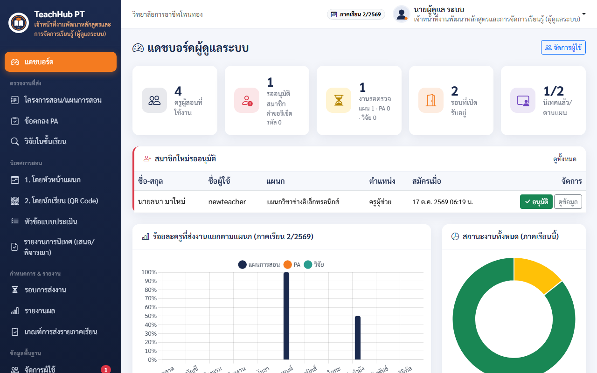

### 1.3 ความปลอดภัยของบัญชีผู้ดูแลระบบ

- บัญชีเริ่มต้นของระบบบังคับให้เปลี่ยนรหัสผ่านเมื่อเข้าครั้งแรก ใช้รหัสผ่านที่คาดเดายาก และไม่ใช้ร่วมกับผู้อื่น
- ต้องมีผู้ดูแลระบบที่ใช้งานได้อย่างน้อย 1 คนเสมอ (ระบบไม่ให้ระงับผู้ดูแลระบบคนสุดท้าย)
- ออกจากระบบทุกครั้งเมื่อใช้เครื่องส่วนกลาง

<!-- pagebreak -->

## ส่วนที่ 2 งานเริ่มต้นภาคเรียน (ทำตามลำดับ)

1. **สำรองข้อมูล** ก่อนเริ่มงาน (ส่วนที่ 8)
2. **ปีการศึกษา/ภาคเรียน**: เพิ่มภาคเรียนใหม่ และตั้งเป็น **ภาคเรียนปัจจุบัน**
3. **แผนกวิชา / รายวิชา**: ตรวจข้อมูลพื้นฐาน
4. **จัดการผู้ใช้**: อนุมัติผู้สมัครใหม่ ตั้งสิทธิ์ และตั้งตำแหน่งผู้ตรวจงาน
5. **รอบการส่งงาน**: กำหนดวันเวลาเปิด-ปิดของโครงการสอน/แผน PA และวิจัย
6. **ประกาศข่าว**: แจ้งกำหนดการและเกณฑ์การส่งให้ครู
7. **ตั้งค่าระบบ**: ตรวจผู้พิจารณารายงานการนิเทศ 3 ขั้น และ URL หลักของระบบ
8. แจ้งครูให้บันทึก **รายวิชาที่สอน** ของภาคเรียนก่อนส่งงาน

<!-- pagebreak -->

## ส่วนที่ 3 จัดการผู้ใช้

### 3.1 อนุมัติและแก้ไขผู้ใช้

เมนู **ข้อมูลพื้นฐาน → จัดการผู้ใช้**

- ผู้สมัครใหม่อยู่ด้านบน (สถานะรออนุมัติ) กด ✓ เพื่อ **อนุมัติ** (ตำแหน่งรองผู้อำนวยการได้สิทธิ์ผู้บริหารอัตโนมัติ)
- แก้ไขข้อมูล/สิทธิ์ ระงับการใช้งาน หรือลบผู้สมัครที่ไม่ถูกต้อง
- **เพิ่มผู้ใช้** เองได้ (ติ๊ก “บังคับเปลี่ยนรหัสผ่านเมื่อเข้าระบบครั้งถัดไป” ไว้ เป็นค่าเริ่มต้น)
- ป้าย Google = ผู้ใช้เชื่อมบัญชี Google แล้ว · ป้าย “ผู้ตรวจ…” = เป็นผู้ตรวจงานตามตำแหน่ง

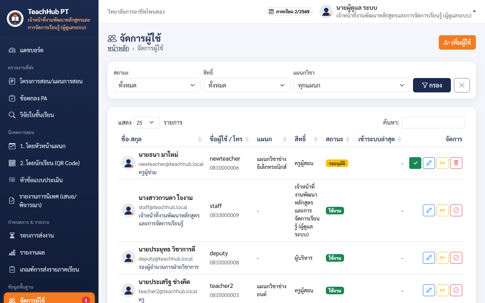

### 3.2 รีเซ็ตรหัสผ่าน

1. คำขอ “ลืมรหัสผ่าน” จากผู้ใช้แสดงด้านบนของหน้าจัดการผู้ใช้
2. ตรวจสอบตัวตนผู้ขอ (โทรศัพท์/พบตัว) แล้วกด **รีเซ็ตรหัสผ่าน**
3. แจ้ง **รหัสผ่านชั่วคราว** ให้ผู้ใช้ ผู้ใช้ต้องตั้งรหัสใหม่เมื่อเข้าระบบ

### 3.3 กำหนดผู้ตรวจงานตามตำแหน่ง

ผู้ตรวจตามตำแหน่งตรวจงานประเภทนั้นได้ **ทุกแผนก** (ยกเว้นงานของตนเอง) หัวหน้าแผนกยังตรวจงานในแผนกได้เหมือนเดิม

| ตำแหน่ง (ต้องสะกดตรงตามนี้) | ตรวจงาน |
|---|---|
| หัวหน้างานส่งเสริมการวิจัย นวัตกรรม และสิ่งประดิษฐ์ | เค้าโครงวิจัย / งานวิจัยในชั้นเรียน |
| หัวหน้างานบุคลากร | ข้อตกลงในการพัฒนางาน (PA) |
| หัวหน้างานพัฒนาหลักสูตรและการจัดการเรียนรู้ | โครงการสอน / แผนการจัดการเรียนรู้ |
| เจ้าหน้าที่งานพัฒนาหลักสูตรและการจัดการเรียนรู้ | โครงการสอน / แผนการจัดการเรียนรู้ |

วิธีกำหนด

1. จัดการผู้ใช้ → กด **แก้ไข** ที่ผู้ใช้
2. ช่อง **ตำแหน่ง** เลือกตำแหน่งจากรายการ แล้วบันทึก
3. ผู้ใช้ได้สิทธิ์ตรวจทันที ครูจะเห็นเมนู **ตรวจงาน (ตามตำแหน่ง)** หัวหน้าแผนกจะเห็นงานประเภทนั้นทุกแผนกในเมนูตรวจงานเดิม

> ผู้ใช้ตั้งหรือเปลี่ยนตำแหน่งผู้ตรวจเองไม่ได้ (ทั้งตอนสมัครและในโปรไฟล์) เมื่อเปลี่ยนคนรับผิดชอบ ให้แก้ตำแหน่งของคนเดิมออกด้วย

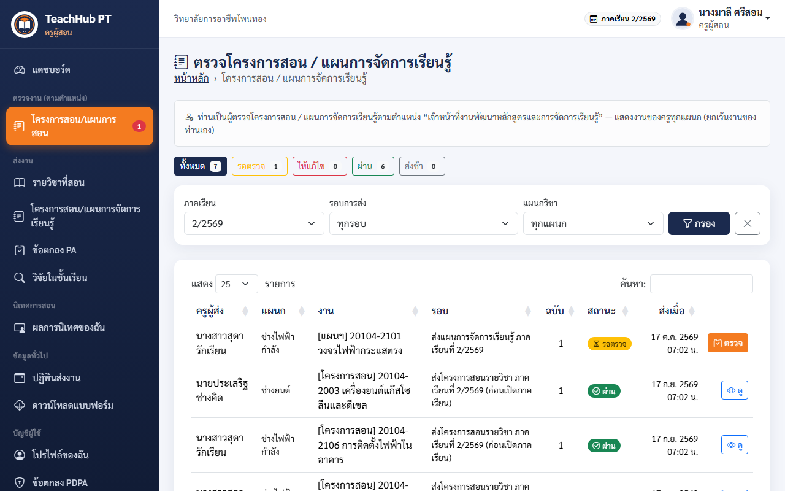

<!-- pagebreak -->

## ส่วนที่ 4 ข้อมูลพื้นฐาน และรอบการส่งงาน

### 4.1 ปีการศึกษา/ภาคเรียน แผนกวิชา รายวิชา

- **ปีการศึกษา/ภาคเรียน**: เพิ่ม/แก้ไข และกด ⭐ เพื่อตั้งเป็นภาคเรียนปัจจุบัน (ใช้เป็นค่าเริ่มต้นของทุกหน้า)
- **แผนกวิชา** และ **รายวิชา**: เพิ่ม/แก้ไขได้ ลบไม่ได้ถ้ามีข้อมูลอ้างอิงอยู่

### 4.2 รอบการส่งงาน

เมนู **กำหนดการ & รายงาน → รอบการส่งงาน**

- เลือกประเภทงาน (โครงการสอน/แผนการจัดการเรียนรู้, PA, วิจัย) ภาคเรียน วันเวลาเปิด-ปิด
- **PA** เลือกรอบข้อตกลงต้นปี/รายงานผลปลายปี และปีงบประมาณ · **วิจัย** เลือกรอบเค้าโครง/ฉบับสมบูรณ์
- **อนุญาตส่งช้า**: ครูส่งหลังกำหนดได้ แต่ติดป้าย “ส่งช้า”
- รอบโครงการสอน/แผน รอบเดียวรับได้ทั้ง 2 ประเภท (ครูเลือกประเภทในฟอร์มส่ง)
- ระบบตรวจเวลาที่เซิร์ฟเวอร์ ครูส่งนอกช่วงเวลาไม่ได้

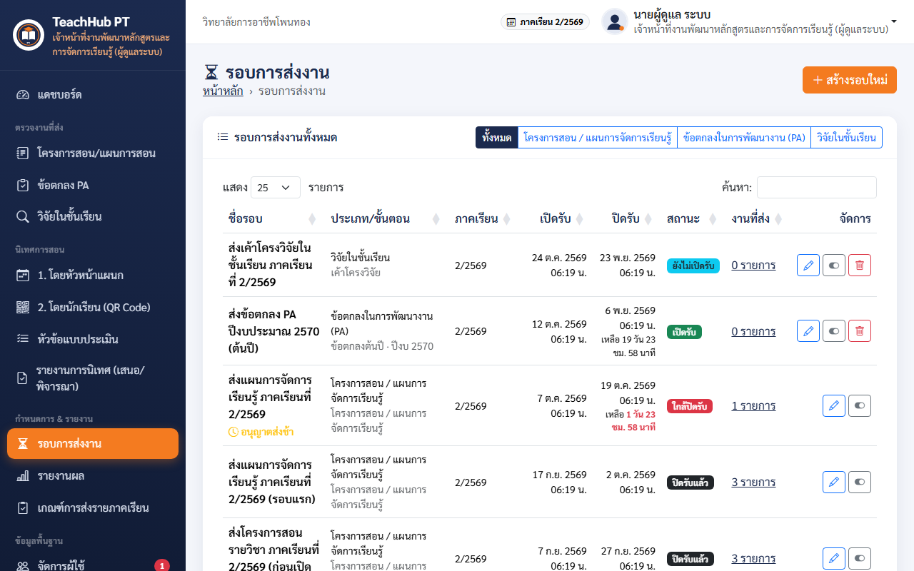

<!-- pagebreak -->

## ส่วนที่ 5 ตรวจงาน

เมนู **ตรวจงานที่ส่ง** (โครงการสอน/แผนการสอน · ข้อตกลง PA · วิจัยในชั้นเรียน)

1. กดชิป **รอตรวจ** แล้วกด **ตรวจ** ที่งาน
2. เปิดไฟล์ดูเนื้อหา เลือก **ผ่าน** หรือ **ให้แก้ไข** (ให้แก้ไขต้องเขียนความเห็น)
3. กด **บันทึกผลการตรวจ** ระบบพาไปงานรอตรวจรายการถัดไป
4. ผู้ดูแลระบบ **เปลี่ยนผลการตรวจ** ที่ตรวจไปแล้วได้ (ผู้ตรวจอื่นแก้ไม่ได้)

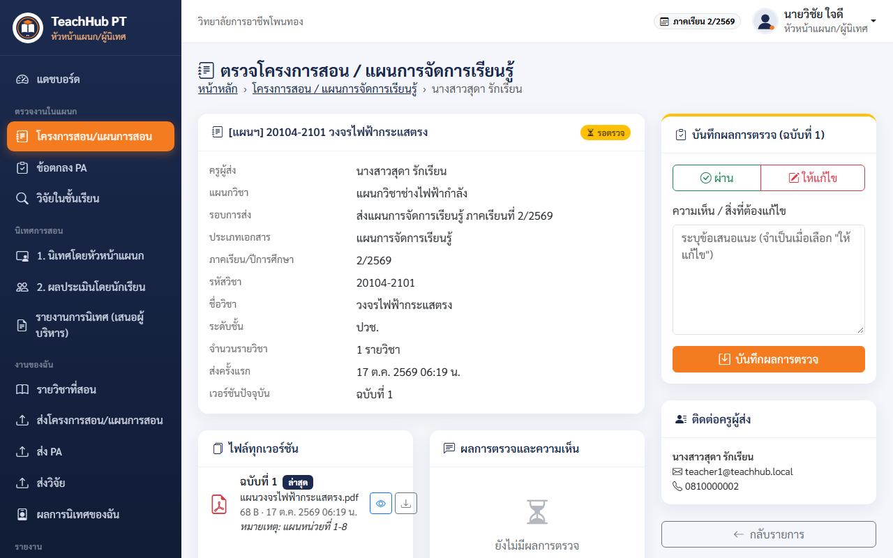

<!-- pagebreak -->

## ส่วนที่ 6 นิเทศการสอน

### 6.1 แบบประเมินโดยนักเรียน (QR Code)

เมนู **นิเทศการสอน → 2. โดยนักเรียน (QR Code) → สร้างแบบประเมิน**

1. เลือกครู ภาคเรียน และรายวิชา (เฉพาะวิชาที่แผนการจัดการเรียนรู้ผ่านแล้ว)
2. เลือกระดับ **ปวช. (ปี 1-3) / ปวส. (ปี 1-2)** และกลุ่ม
3. กำหนดช่วงเวลาเปิด-ปิด และจำนวนผู้ตอบสูงสุด (แนะนำใส่จำนวนนักเรียนในห้อง)
4. บันทึก → ได้ **QR Code** และลิงก์ กด **พิมพ์ป้าย QR** หรือให้ครูเปิดฉายจากเมนูของครู
5. ปุ่ม **ปิดรับ** หยุดการประเมิน · **สร้างลิงก์ใหม่** ทำให้ QR เดิมใช้ไม่ได้

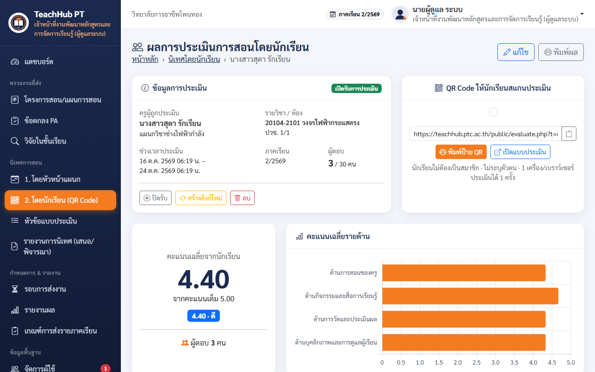

> QR Code ใช้ “URL หลักของระบบ” ในตั้งค่าระบบ ถ้าเป็น localhost โทรศัพท์นักเรียนจะเปิดไม่ได้

### 6.2 หัวข้อแบบประเมิน

เมนู **นิเทศการสอน → หัวข้อแบบประเมิน** แก้ไข เพิ่ม หรือปิดใช้หัวข้อได้ 2 ชุด

- ชุดหัวหน้าแผนกนิเทศ: 15 ข้อ 6 ด้าน
- ชุดนักเรียนประเมิน: 10 ข้อ (ภาษาที่นักเรียนเข้าใจง่าย)

ผลการนิเทศที่บันทึกไปแล้วไม่เปลี่ยนเมื่อแก้หัวข้อ

### 6.3 รายงานการนิเทศ (ผู้พิจารณาขั้นที่ 1)

หัวหน้างานพัฒนาหลักสูตรฯ เป็นผู้พิจารณา **ขั้นที่ 1** ของรายงานการนิเทศจากหัวหน้าแผนก

1. เมนู **นิเทศการสอน → รายงานการนิเทศ (เสนอ/พิจารณา)** ตัวเลขสีแดง = รายงานที่รอพิจารณา
2. เปิดรายงาน อ่านสรุปผล คะแนน และภาพถ่าย
3. เขียนความเห็น แล้วเลือก **เห็นควรเสนอ** (ไปรองผู้อำนวยการฝ่ายวิชาการ) หรือ **ส่งกลับแก้ไข**

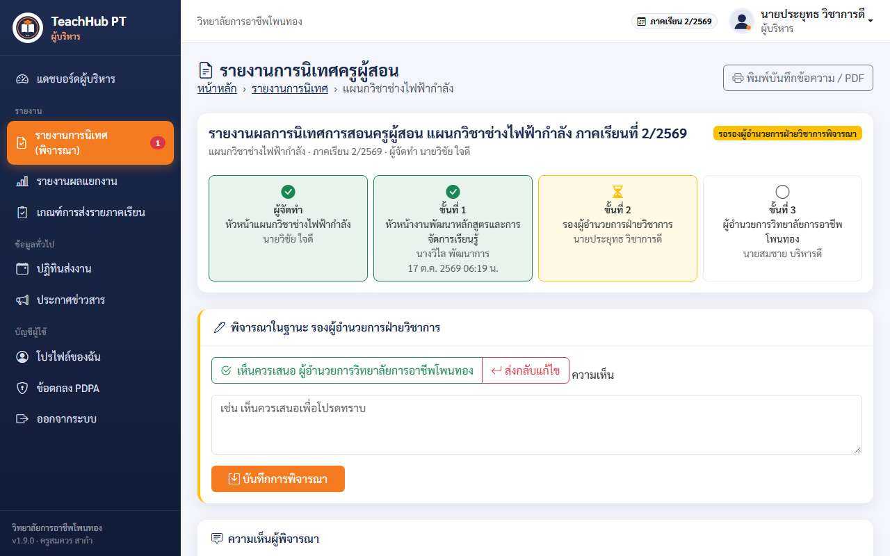

ผู้พิจารณาทั้ง 3 ขั้นกำหนดที่ **ตั้งค่าระบบ → ผู้พิจารณารายงานการนิเทศ** (ต้องเป็นบัญชีสิทธิ์ผู้ดูแลระบบหรือผู้บริหาร)

<!-- pagebreak -->

## ส่วนที่ 7 รายงานผล

- **รายงานผล**: เลือกงาน (โครงการสอน/แผน, PA, วิจัย, นิเทศ 2 รูปแบบ) กรองภาคเรียน รอบ แผนก สถานะ → ร้อยละ กราฟรายแผนก ส่งออก Excel พิมพ์ PDF
- **เกณฑ์การส่งรายภาคเรียน**: ตรวจครูที่ยังส่งโครงการสอนไม่ครบทุกวิชา หรือยังไม่ส่งแผน ส่งออก Excel เพื่อติดตาม

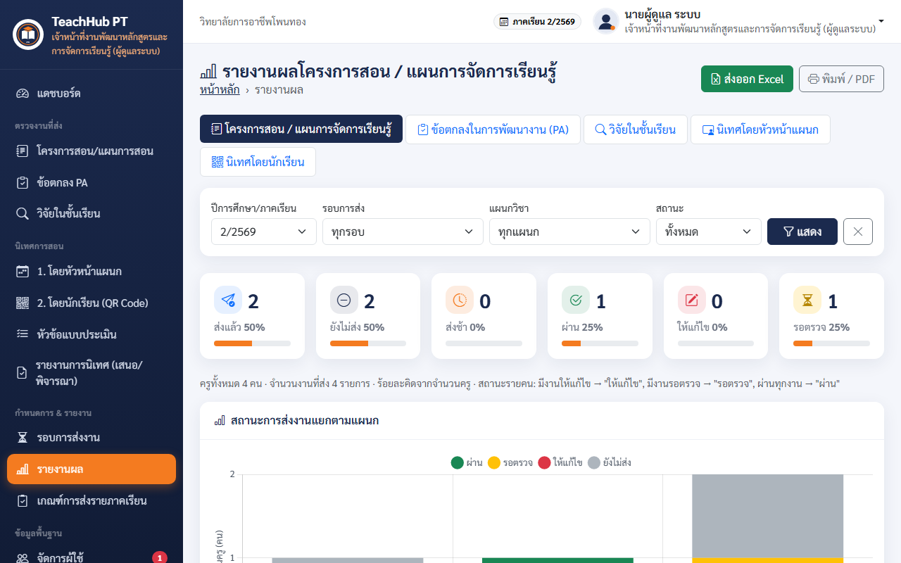

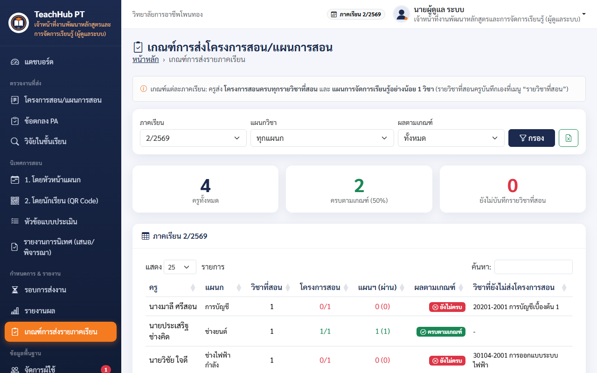

<!-- pagebreak -->

## ส่วนที่ 8 สำรอง / กู้คืนข้อมูล

เมนู **ระบบ → สำรอง / กู้คืนข้อมูล**

### 8.1 สำรองข้อมูล

1. เปิด **รวมไฟล์แนบ** (แผน PA วิจัย รูปนิเทศ รูปโปรไฟล์) ใส่บันทึกช่วยจำ แล้วกด **สำรองข้อมูล**
2. ได้ไฟล์ .zip ในรายการ กด **ดาวน์โหลด** เก็บไว้นอกเครื่อง เช่น Google Drive ของงาน
3. **สำรองอัตโนมัติ**: เปิดสวิตช์ ระบบสำรองวันละครั้งเมื่อผู้ดูแลระบบเปิดแดชบอร์ด และเก็บไว้ตามจำนวนไฟล์ที่กำหนด

### 8.2 กู้คืนข้อมูล

1. เลือกไฟล์สำรองบนเซิร์ฟเวอร์ หรืออัปโหลดไฟล์ .zip จากเครื่อง
2. พิมพ์คำว่า **กู้คืน** และใส่รหัสผ่านของท่าน
3. ระบบสำรองข้อมูลปัจจุบันเป็นไฟล์ “ก่อนกู้คืน” ให้อัตโนมัติ แล้วจึงกู้คืน
4. หลังกู้คืน ทุกคนต้องเข้าสู่ระบบใหม่

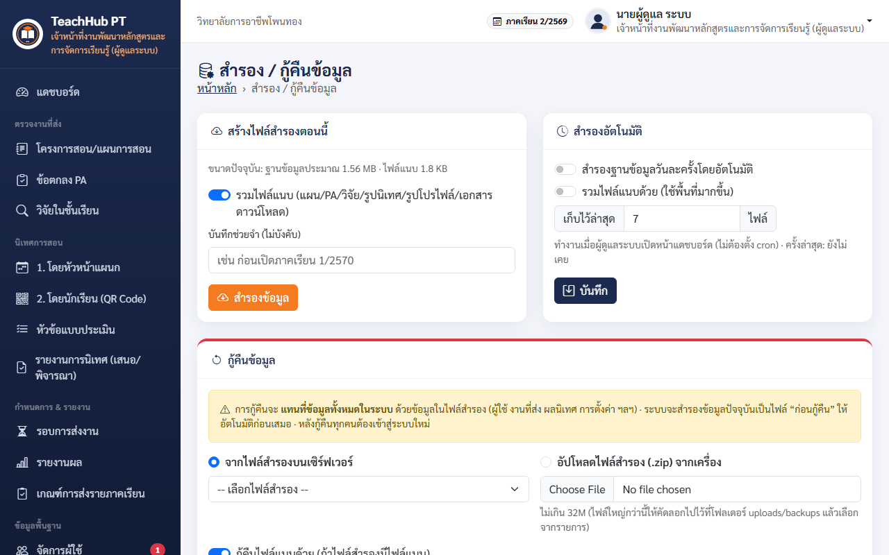

> แนะนำสำรองข้อมูลอย่างน้อยสัปดาห์ละ 1 ครั้ง และทุกครั้งก่อนปิดรอบการส่งงานสำคัญ · ไฟล์สำรองมีข้อมูลส่วนบุคคล เก็บในที่ที่ปลอดภัยเท่านั้น

<!-- pagebreak -->

## ส่วนที่ 9 ตั้งค่าระบบ และงานอื่น

### 9.1 ตั้งค่าระบบ

เมนู **ระบบ → ตั้งค่าระบบ**

- ชื่อวิทยาลัย ชื่อระบบ สโลแกน โลโก้ สีธีม
- ขนาดไฟล์สูงสุด และนามสกุลไฟล์ที่อนุญาต
- เปิด/ปิดการสมัครสมาชิก และเวลาหมดอายุการใช้งาน (นาที)
- **ผู้พิจารณารายงานการนิเทศ 3 ขั้น**
- **URL หลักของระบบ** (ใช้สร้าง QR Code)
- **เข้าสู่ระบบด้วย Google**: ใส่ Client ID / Client Secret จาก Google Cloud Console จำกัดโดเมนอีเมลได้ (ขั้นตอนละเอียดในคู่มือติดตั้ง)

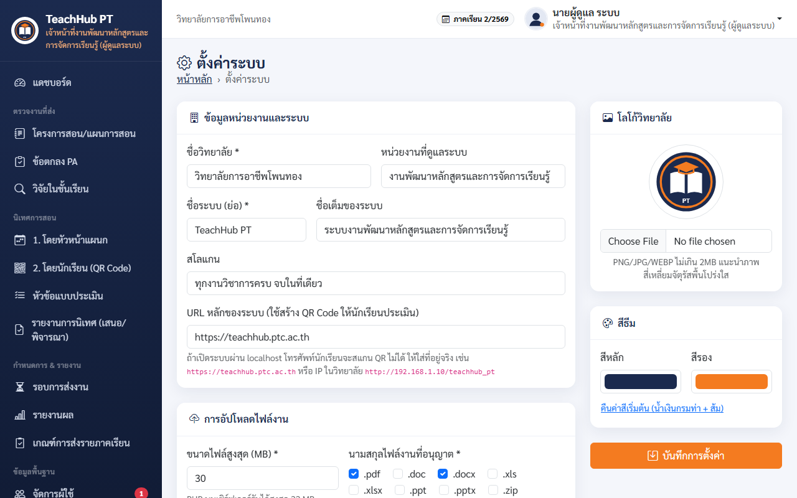

### 9.2 งานอื่นของผู้ดูแลระบบ

- **ข้อตกลง PDPA**: แก้ไขเนื้อหา ประกาศฉบับใหม่ (ทุกคนต้องยอมรับอีกครั้ง) ดูสถานะการยอมรับรายบุคคล
- **ประกาศข่าว / เอกสารดาวน์โหลด**: เผยแพร่ข่าวและแบบฟอร์มบนหน้าแรก (เช่น คู่มือผู้ใช้งานฉบับ PDF)
- **บันทึกการใช้งาน (Log)**: ตรวจสอบย้อนหลังว่าใครทำอะไร เมื่อไร จาก IP ใด
- **ตรวจสอบระบบ**: ตรวจความพร้อมของเซิร์ฟเวอร์ ต้องไม่มีรายการสีแดง

### 9.3 ดูแลกระดานข่าว

เมนู **ติดต่อประสานงาน → กระดานข่าว** (ตัวเลขสีแดงบนเมนู = จำนวนกระทู้ที่ยังรอตอบ)

1. เปิดกระทู้ที่ **รอตอบ** แล้วตอบ (คำตอบของผู้ดูแลระบบมีป้าย “ผู้ดูแลระบบ” และแถบสีน้ำเงิน) สถานะเปลี่ยนเป็น **ตอบแล้ว** อัตโนมัติ
2. กล่อง **ผู้ดูแลระบบ** ด้านขวา: เปลี่ยนสถานะ และ **ปักหมุด** กระทู้สำคัญไว้บนสุด
3. ข้อเสนอพัฒนาระบบ: ใช้ **รับไว้พัฒนา** → **ดำเนินการแล้ว** เพื่อแจ้งความคืบหน้าให้ผู้เสนอทราบ
4. **ปิดกระทู้** เมื่อจบเรื่อง (สมาชิกตอบเพิ่มไม่ได้) · แก้ไข/ลบข้อความที่ไม่เหมาะสมได้ทุกข้อความ

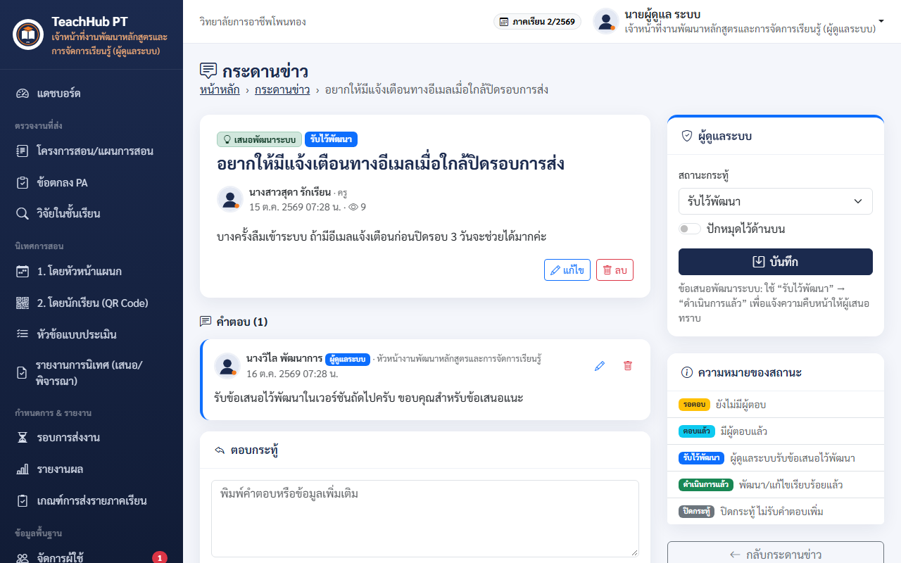

<!-- pagebreak -->

## ส่วนที่ 10 การดูแลประจำ ปัญหาที่พบบ่อย และแบบฝึกหัด

### 10.1 รายการดูแลประจำ

| ความถี่ | งาน |
|---|---|
| ทุกวัน | อนุมัติผู้สมัครใหม่ ตอบคำขอรีเซ็ตรหัสผ่าน ตรวจงานรอตรวจ ตอบกระทู้รอตอบในกระดานข่าว |
| ทุกสัปดาห์ | สำรองข้อมูลและดาวน์โหลดเก็บนอกเครื่อง ดูรายงานเกณฑ์การส่ง |
| ก่อนปิดรอบ | ประกาศเตือนครู ตรวจรายงานผลร้อยละการส่ง |
| ต้นภาคเรียน | ทำงานตามส่วนที่ 2 ทั้งหมด |
| ทุกภาคเรียน | ตรวจบันทึกการใช้งาน ระงับบัญชีผู้ที่ย้าย/ลาออก ตรวจผู้ตรวจตามตำแหน่ง |

### 10.2 ปัญหาที่พบบ่อย

| อาการ | วิธีแก้ |
|---|---|
| ครูเข้าระบบไม่ได้หลังสมัคร | อนุมัติที่หน้าจัดการผู้ใช้ |
| ครูลืมรหัสผ่าน | รีเซ็ตรหัสผ่านที่คำขอด้านบนของหน้าจัดการผู้ใช้ |
| ครูไม่เห็นรอบการส่ง | ตรวจวันเวลาเปิด-ปิด สถานะเปิดใช้ และภาคเรียนของรอบ |
| ครูไม่มีวิชาให้เลือกตอนส่ง | ครูยังไม่บันทึกรายวิชาที่สอนของภาคเรียนของรอบนั้น |
| สร้างแบบประเมิน/ตารางนิเทศแล้วไม่มีวิชาให้เลือก | แผนการจัดการเรียนรู้ของวิชานั้นยังไม่ผ่าน ให้ตรวจแผนก่อน |
| นักเรียนเปิด QR ไม่ได้ | ตั้ง URL หลักของระบบให้เป็นที่อยู่ที่โทรศัพท์เข้าถึงได้ |
| ผู้ตรวจตามตำแหน่งไม่เห็นเมนูตรวจ | ตรวจการสะกดตำแหน่งให้ตรงตามหัวข้อ 3.3 และสถานะบัญชีเป็นใช้งาน |
| ปุ่ม Google ไม่ทำงาน | ตรวจ Client ID/Secret และ Redirect URI ใน Google Cloud ให้ตรงกับหน้าตั้งค่า (ต้องเป็น https) |
| ข้อมูลผิดพลาดจำนวนมาก | กู้คืนจากไฟล์สำรองล่าสุด (ส่วนที่ 8.2) |

### 10.3 แบบฝึกหัดสำหรับผู้ดูแลระบบ (ใช้บัญชีทดลอง)

| ที่ | กิจกรรม | ผลที่ควรได้ |
|---|---|---|
| 1 | อนุมัติผู้สมัครใหม่ 1 คน แล้วตั้งสิทธิ์เป็นครู | ผู้ใช้เข้าสู่ระบบได้ |
| 2 | ตั้งตำแหน่งครูคนหนึ่งเป็น “หัวหน้างานบุคลากร” | ครูคนนั้นมีเมนู ตรวจงาน (ตามตำแหน่ง) → ข้อตกลง PA |
| 3 | สร้างรอบการส่งโครงการสอน/แผน เปิด 7 วัน อนุญาตส่งช้า | รอบแสดงในหน้าครู |
| 4 | สร้างแบบประเมินโดยนักเรียน แล้วพิมพ์ป้าย QR | ได้ป้าย QR พร้อมชื่อครูและวิชา |
| 5 | เปิดรายงานเกณฑ์การส่ง แล้วส่งออก Excel | ได้ไฟล์ Excel ภาษาไทย |
| 6 | สำรองข้อมูลรวมไฟล์แนบ แล้วดาวน์โหลด | ได้ไฟล์ .zip |
| 7 | พิจารณารายงานการนิเทศขั้นที่ 1 | รายงานไปรองผู้อำนวยการ |
| 8 | ตอบกระทู้ “เสนอพัฒนาระบบ” แล้วเปลี่ยนสถานะเป็น “รับไว้พัฒนา” และปักหมุด | กระทู้อยู่บนสุด ผู้เสนอเห็นสถานะใหม่ |

> ติดต่อผู้พัฒนาระบบ: ครูสมควร สากำ · งานพัฒนาหลักสูตรและการจัดการเรียนรู้ วิทยาลัยการอาชีพโพนทอง
