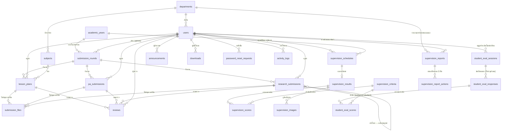

# TeachHub PT — การออกแบบฐานข้อมูล (ER Diagram)

ฐานข้อมูล: `teachhub_pt` (utf8mb4_unicode_ci, InnoDB, timezone +07:00) — 23 ตาราง (เวอร์ชัน 1.1)

## คำอธิบายความสัมพันธ์

| กลุ่ม | ตาราง | ความสัมพันธ์สำคัญ |
|---|---|---|
| ข้อมูลหลัก | `departments`, `academic_years`, `subjects`, `users` | ผู้ใช้ 1 คนสังกัด 1 แผนก (หัวหน้าแผนกเห็นเฉพาะครูแผนกตนเองผ่าน `department_id`) |
| รอบการส่ง | `submission_rounds` | `type` = lesson_plan / pa / research, `phase` แยกขั้น (PA: agreement/report, วิจัย: proposal/final), มี `open_at`, `close_at`, `allow_late`, `is_active` |
| งานที่ส่ง | `lesson_plans`, `pa_submissions`, `research_submissions` | ทุกงานผูกกับ รอบ + ครู, มี `status` (pending/approved/revision), `is_late`, `current_version` |
| ไฟล์ & ผลตรวจ | `submission_files`, `reviews` | อ้างอิงแบบ polymorphic ด้วย (`submission_type`, `submission_id`, `version`) เก็บไฟล์ทุกเวอร์ชันและความเห็นทุกครั้ง |
| นิเทศ 1: โดยหัวหน้าแผนก | `supervision_schedules` → `supervision_results` (1:1) → `supervision_scores` (1:N), `supervision_images` | คะแนนเก็บสำเนาชื่อหัวข้อไว้ เผื่อ admin แก้หัวข้อภายหลัง ผลเดิมไม่เปลี่ยน |
| รายวิชาที่สอน | `teaching_subjects` (ครู + ภาคเรียน + รหัสวิชา ไม่ซ้ำ) ↔ `lesson_plans` (`doc_type` = outline โครงการสอน / plan แผนการจัดการเรียนรู้) | เกณฑ์: โครงการสอนครบทุกวิชาที่สอน + แผนฯ อย่างน้อย 1 วิชา; วิชาที่นิเทศ/ประเมิน = แผนฯ ที่ผ่านแล้ว |
| นิเทศ 2: โดยนักเรียน | `student_eval_sessions` (มี `token` สำหรับลิงก์/QR, กลุ่มนักเรียน `level` ปวช./ปวส. + `grade_year` + `group_no`) → `student_eval_responses` (1:N) → `student_eval_scores` (1:N) | นักเรียนไม่ต้องเป็นสมาชิก ไม่เก็บชื่อ/IP ของผู้ตอบ |
| หัวข้อประเมิน | `supervision_criteria` | คอลัมน์ `audience` แยกชุด: `supervisor` (หัวหน้าแผนก) / `student` (นักเรียน) |
| ระบบ | `announcements`, `downloads`, `settings`, `password_reset_requests`, `activity_logs` | settings เป็น key-value, log เก็บ user/action/IP/เวลา |

## กฎการลบ (Foreign Key)
- ลบครู → งานที่ส่งของครูถูกลบตาม (CASCADE) — แนะนำให้ "ระงับ" แทนการลบ
- ลบรอบการส่งที่มีงานแล้ว → ไม่อนุญาต (RESTRICT)
- ลบแผนก/รายวิชา/ภาคเรียน → ค่าอ้างอิงเป็น NULL (SET NULL) ข้อมูลงานไม่หาย
- ลบผู้นิเทศที่มีตารางนิเทศ → ไม่อนุญาต (RESTRICT)
- ลบแบบประเมินโดยนักเรียน → คำตอบและคะแนนทั้งหมดของรายการนั้นถูกลบตาม (CASCADE)
