# คู่มือการใช้งานระบบ TeachHub PT สำหรับผู้ใช้งาน

ระบบการส่งงานและรายงานกิจกรรม วิทยาลัยการอาชีพโพนทอง

## วิธีใช้คู่มือนี้

คู่มือนี้สำหรับ **ครูผู้สอน หัวหน้าแผนกวิชา ผู้บริหาร และนักเรียน นักศึกษา** ทุกคนอ่านส่วนที่ 1 แล้วอ่านส่วนของบทบาทตนเอง
(งานของผู้ดูแลระบบอยู่ใน “คู่มือสำหรับผู้ดูแลระบบ” แยกต่างหาก)

| ส่วน | สำหรับ | เนื้อหา |
|---|---|---|
| 1 | ทุกคน | รู้จักระบบ สมัครสมาชิก เข้าสู่ระบบ โปรไฟล์ PDPA กระดานข่าว |
| 2 | ครูผู้สอน | รายวิชาที่สอน ส่งโครงการสอน/แผน PA วิจัย ผลนิเทศ ผู้ตรวจงานตามตำแหน่ง |
| 3 | นักเรียน นักศึกษา | ประเมินการสอนผ่าน QR Code |
| 4 | หัวหน้าแผนกวิชา | ตรวจงาน นิเทศการสอน รายงานการนิเทศ |
| 5 | ผู้บริหาร | แดชบอร์ด พิจารณารายงานการนิเทศ รายงานผล |
| 6 | ทุกคน | คำถามที่พบบ่อย และแบบฝึกหัดระหว่างอบรม |

> ภาพหน้าจอในคู่มือใช้ข้อมูลทดลอง ชื่อบุคคลและรายวิชาเป็นตัวอย่างเท่านั้น

<!-- pagebreak -->

## ส่วนที่ 1 สำหรับทุกคน

### 1.1 รู้จักระบบ TeachHub PT

TeachHub PT รวมงานวิชาการของครูไว้ในที่เดียว ได้แก่

- **โครงการสอนและแผนการจัดการเรียนรู้** ส่งไฟล์ ตรวจ ให้แก้ไข และเก็บทุกฉบับ
- **ข้อตกลงในการพัฒนางาน (PA)** ข้อตกลงต้นปีและรายงานผลปลายปี
- **วิจัยในชั้นเรียน** เค้าโครงและรายงานฉบับสมบูรณ์
- **นิเทศการสอน 2 รูปแบบ** โดยหัวหน้าแผนกวิชา และโดยนักเรียน นักศึกษา (QR Code)
- **รายงานการนิเทศ** เสนอหัวหน้างานพัฒนาหลักสูตรฯ → รองผู้อำนวยการฝ่ายวิชาการ → ผู้อำนวยการ

เปิดใช้งานผ่านเว็บเบราว์เซอร์ (Chrome, Edge, Safari) ได้ทั้งคอมพิวเตอร์และโทรศัพท์มือถือ

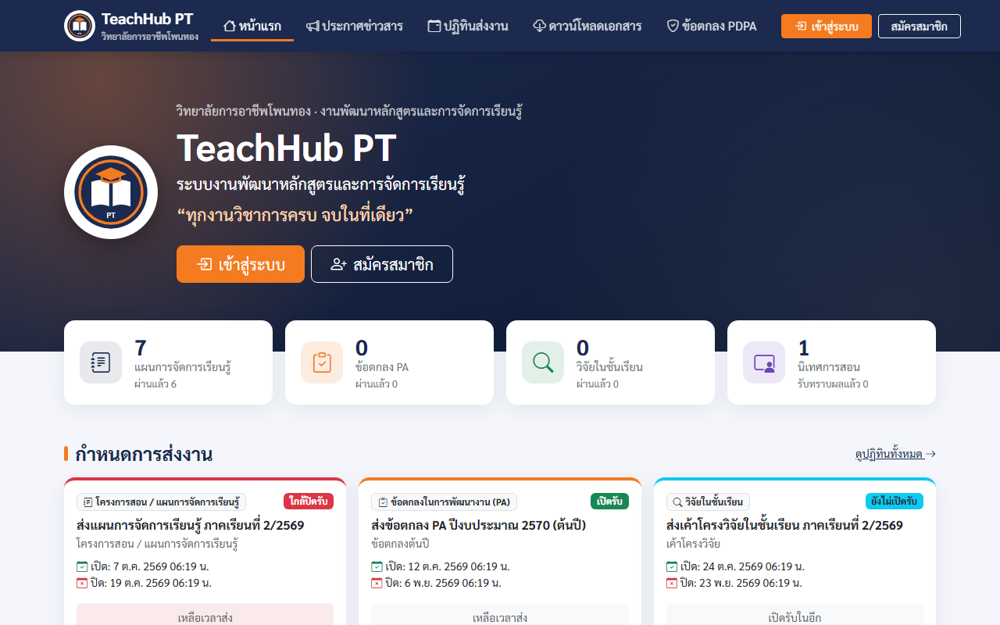

### 1.2 สมัครสมาชิก

1. หน้าแรก กดปุ่ม **สมัครสมาชิก**
2. กรอก คำนำหน้า ชื่อ นามสกุล แผนกวิชา ตำแหน่ง อีเมล เบอร์โทรศัพท์
   - รองผู้อำนวยการไม่ต้องเลือกแผนกวิชา
3. ตั้ง **ชื่อผู้ใช้** (a-z, 0-9 ยาว 4-30 ตัว) และ **รหัสผ่าน** (อย่างน้อย 8 ตัว มีทั้งตัวอักษรและตัวเลข)
4. ติ๊ก **ยอมรับข้อตกลง PDPA** แล้วกด **สมัครสมาชิก**
5. รอผู้ดูแลระบบ **อนุมัติ** จึงจะเข้าสู่ระบบได้

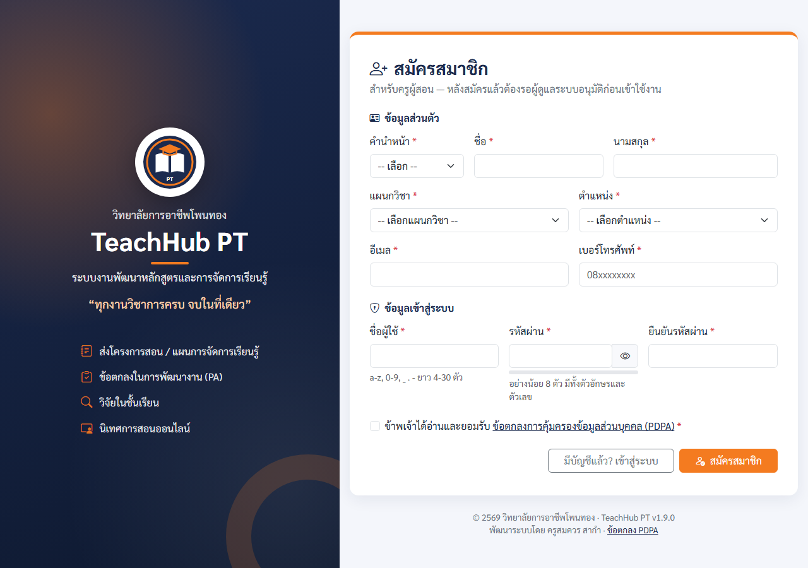

> ถ้าวิทยาลัยเปิดใช้ **สมัครด้วยบัญชี Google** จะมีปุ่มด้านบนของฟอร์ม กดแล้วเลือกบัญชี Google ระบบเติมชื่อและอีเมลให้ ไม่ต้องตั้งรหัสผ่าน

### 1.3 เข้าสู่ระบบ / ออกจากระบบ

1. กด **เข้าสู่ระบบ** กรอกชื่อผู้ใช้ (หรืออีเมล) และรหัสผ่าน
2. หรือกด **เข้าสู่ระบบด้วย Google** (ถ้าเปิดใช้)
3. ระบบพาไปหน้าแดชบอร์ดตามบทบาทของท่าน
4. ออกจากระบบ: เมนูด้านซ้าย → **ออกจากระบบ**

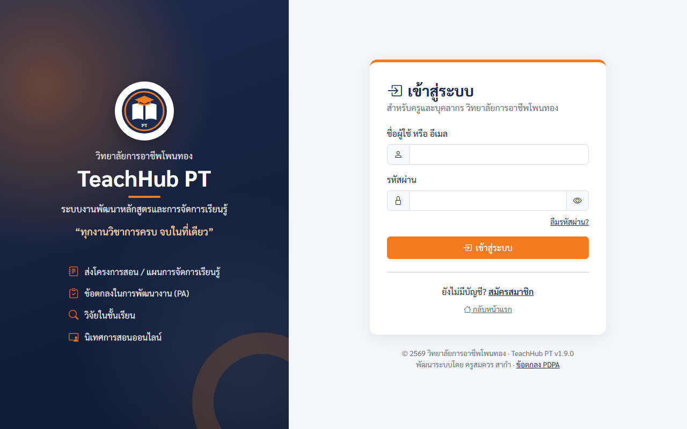

ข้อควรรู้

- กรอกรหัสผ่านผิด 5 ครั้ง ต้องรอ 15 นาที
- ไม่ใช้งานเกิน 30 นาที ระบบออกจากระบบให้อัตโนมัติ
- **ลืมรหัสผ่าน** กดลิงก์ “ลืมรหัสผ่าน?” แล้วรอผู้ดูแลระบบรีเซ็ตให้ (จะได้รหัสชั่วคราวและต้องเปลี่ยนรหัสใหม่เมื่อเข้าระบบ)
- เข้าครั้งแรกระบบจะให้อ่านและกด **ยอมรับข้อตกลง PDPA** ก่อนใช้งาน

### 1.4 โปรไฟล์ของฉัน

เมนูด้านซ้าย → **โปรไฟล์ของฉัน**

- แก้ไขคำนำหน้า ชื่อ ตำแหน่ง วิทยฐานะ อีเมล เบอร์โทร และรูปโปรไฟล์
- **เปลี่ยนรหัสผ่าน**
- **เชื่อมต่อบัญชี Google** เพื่อเข้าสู่ระบบด้วยปุ่ม Google ครั้งต่อไป
- ชื่อผู้ใช้ แผนกวิชา สิทธิ์ และตำแหน่งผู้ตรวจงาน แก้เองไม่ได้ ต้องแจ้งผู้ดูแลระบบ

### 1.5 กระดานข่าว (ติดต่อประสานงาน)

เมนู **ติดต่อประสานงาน → กระดานข่าว** — อ่านและโพสต์ได้เฉพาะสมาชิกที่เข้าสู่ระบบ

| หมวด | ใช้เมื่อ |
|---|---|
| ประสานงานทั่วไป | แจ้งข่าว นัดหมาย หรือประสานงานระหว่างสมาชิก |
| สอบถามการใช้งาน | สงสัยวิธีใช้ระบบ |
| เสนอพัฒนาระบบ | อยากให้ระบบมีความสามารถเพิ่มเติม |
| แจ้งปัญหา/ข้อผิดพลาด | ระบบทำงานผิดปกติ (บอกว่าทำอะไร ที่หน้าไหน เกิดอะไรขึ้น) |

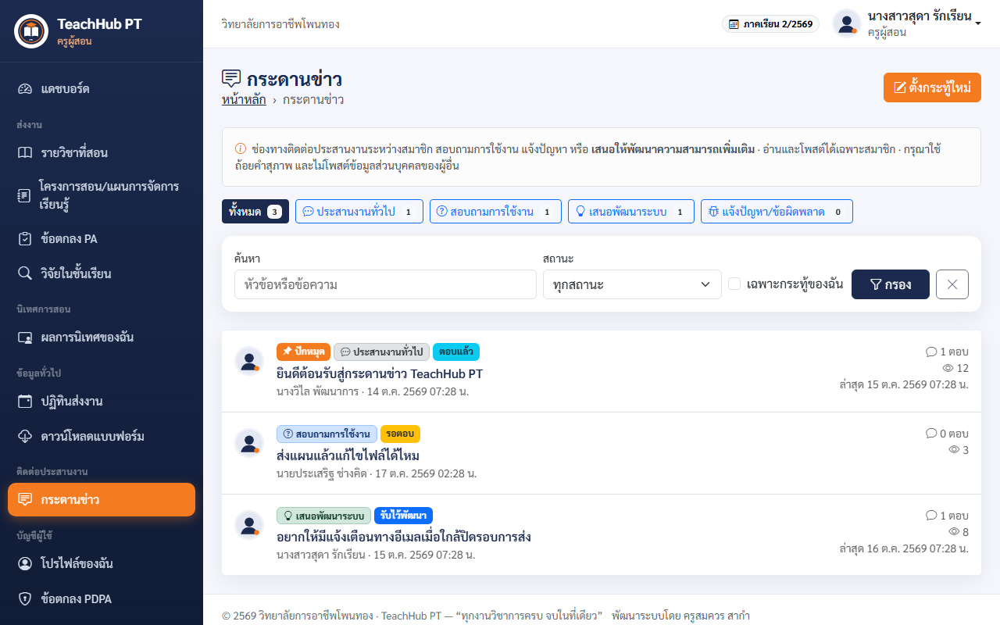

ตั้งกระทู้

1. กด **ตั้งกระทู้ใหม่** เลือก **หมวด** กรอก **หัวข้อ** และ **รายละเอียด**
2. กด **โพสต์กระทู้**

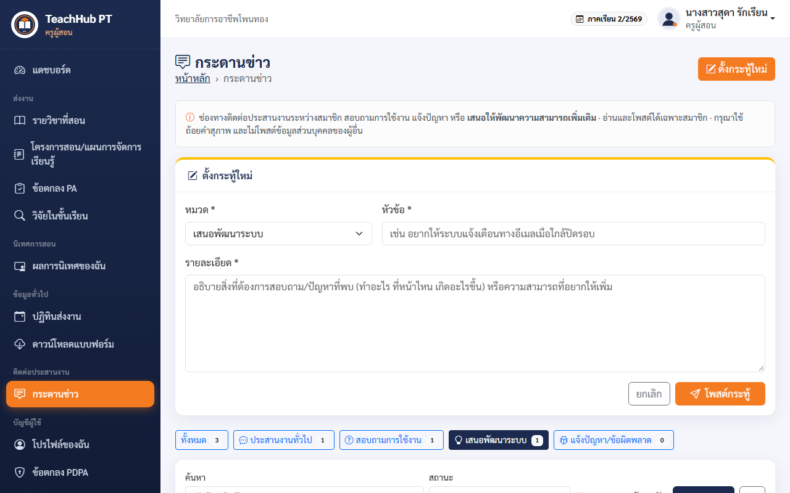

ตอบ / แก้ไข / ลบ

- เปิดกระทู้ พิมพ์ในช่อง **ตอบกระทู้** แล้วกด **ส่งคำตอบ**
- แก้ไขหรือลบได้เฉพาะข้อความของตนเอง (ลบกระทู้ได้เมื่อยังไม่มีผู้ตอบ)
- ค้นหาด้วยคำ กรองตามหมวด/สถานะ หรือเลือก **เฉพาะกระทู้ของฉัน**

สถานะกระทู้: **รอตอบ** → **ตอบแล้ว** (เมื่อมีผู้อื่นตอบ) → ข้อเสนอพัฒนาระบบอาจเป็น **รับไว้พัฒนา** → **ดำเนินการแล้ว** · **ปิดกระทู้** = ไม่รับคำตอบเพิ่ม

> ใช้ถ้อยคำสุภาพ และไม่โพสต์ข้อมูลส่วนบุคคลของผู้อื่น (เลขบัตรประชาชน รหัสผ่าน ฯลฯ)

<!-- pagebreak -->

## ส่วนที่ 2 สำหรับครูผู้สอน

### 2.1 แดชบอร์ดครู

แดชบอร์ดแสดงสรุปงานที่ส่งแล้ว งานที่ต้องแก้ไข รอบการส่งที่เปิดอยู่พร้อมนับถอยหลัง และตารางนิเทศที่กำลังจะมาถึง

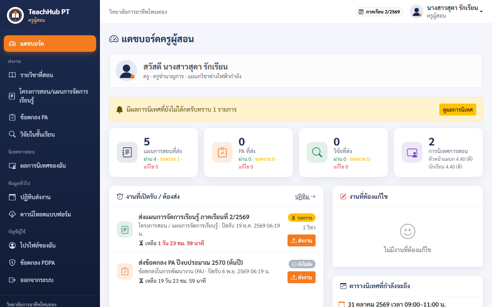

### 2.2 เกณฑ์การส่งงานในแต่ละภาคเรียน

| งาน | เกณฑ์ |
|---|---|
| โครงการสอน | ส่ง **ครบทุกรายวิชา** ที่สอนในภาคเรียน |
| แผนการจัดการเรียนรู้ | ส่ง **อย่างน้อย 1 รายวิชา** |

> รายวิชาที่หัวหน้าแผนกวิชาและนักเรียน นักศึกษาจะประเมิน คือรายวิชาที่ **แผนการจัดการเรียนรู้ผ่านแล้ว** ในภาคเรียนนั้น

### 2.3 บันทึกรายวิชาที่สอน (ทำก่อนส่งงาน)

เมนู **ส่งงาน → รายวิชาที่สอน**

1. เลือก **ภาคเรียน** (ค่าเริ่มต้นคือภาคเรียนปัจจุบัน)
2. ช่อง “เพิ่มรายวิชาที่สอน” กรอก **รหัสวิชา** **ชื่อวิชา** และ **ระดับชั้น** (ปวช./ปวส.) แล้วกด **เพิ่มรายวิชา**
3. ทำซ้ำจนครบทุกวิชาที่สอน
4. ตารางแสดงสถานะโครงการสอนและแผนของแต่ละวิชา กดลิงก์ **ส่ง** เพื่อไปหน้าส่งงานได้ทันที
5. กล่องด้านขวาบอกว่า **ครบตามเกณฑ์** แล้วหรือยัง

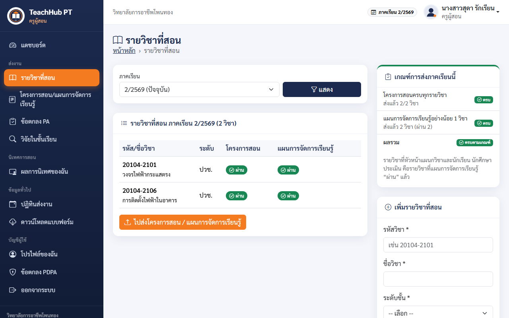

### 2.4 ส่งโครงการสอน / แผนการจัดการเรียนรู้

เมนู **ส่งงาน → โครงการสอน/แผนการจัดการเรียนรู้**

1. เลือก **รอบการส่ง** (เฉพาะรอบที่เปิดรับอยู่)
2. เลือก **ประเภทเอกสาร**: โครงการสอน หรือ แผนการจัดการเรียนรู้
3. เลือก **รายวิชา** (มาจากรายวิชาที่สอน)
4. กรอก **จำนวนรายวิชา** แนบไฟล์ **PDF หรือ DOCX** และหมายเหตุ (ถ้ามี)
5. กด **ส่งงาน** → สถานะเป็น **รอตรวจ** (สีเหลือง)

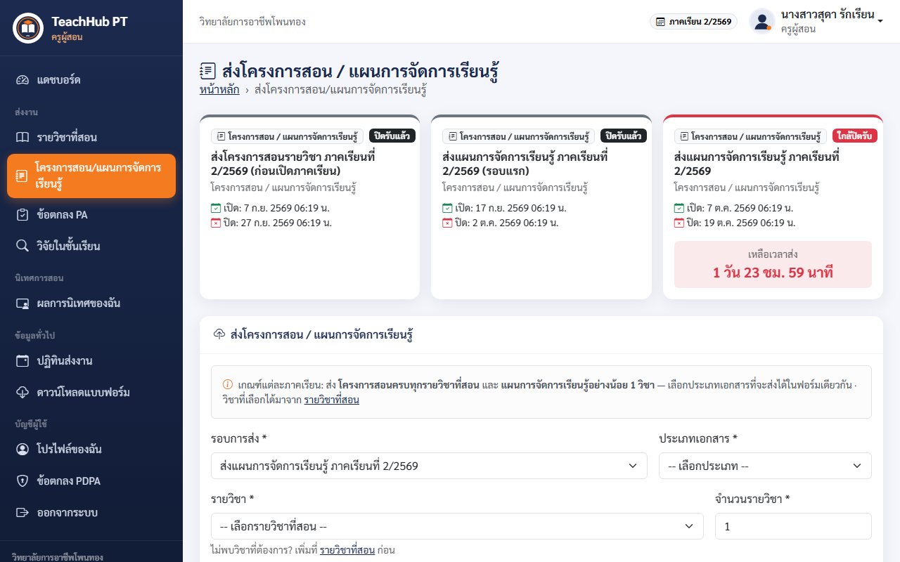

สถานะของงาน

| สถานะ | ความหมาย | สิ่งที่ครูทำ |
|---|---|---|
| รอตรวจ | ส่งแล้ว รอผู้ตรวจตามตำแหน่ง/หัวหน้าแผนก/ผู้ดูแลระบบตรวจ | รอผล (ลบงานได้ถ้ายังไม่ถูกตรวจและรอบยังเปิด) |
| ให้แก้ไข | ผู้ตรวจให้แก้ พร้อมความเห็น | เปิดงาน อ่านความเห็น แล้ว **ส่งฉบับแก้ไข** |
| ผ่าน | ผ่านการตรวจแล้ว | ไม่ต้องทำอะไร |
| ส่งช้า | ส่งหลังกำหนด (รอบที่อนุญาตส่งช้า) | ป้ายติดถาวร |

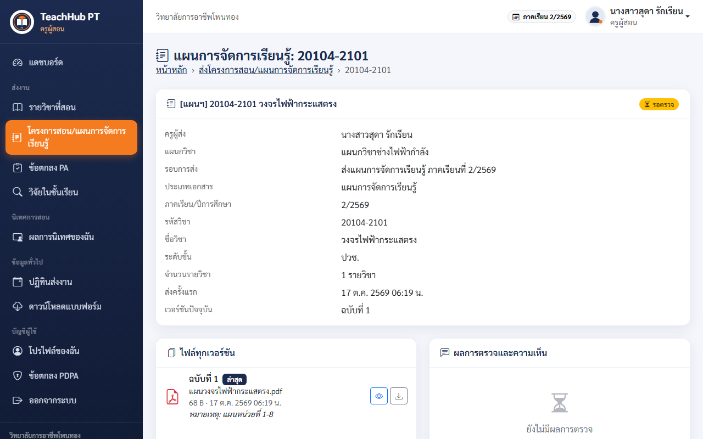

### 2.5 ส่งงานฉบับแก้ไข

1. เปิดรายการที่สถานะ **ให้แก้ไข** (ปุ่มสีแดง “แก้ไข”)
2. อ่านความเห็นของผู้ตรวจในกรอบสีแดง
3. ช่อง **ส่งฉบับแก้ไข** แนบไฟล์ใหม่ เขียนสิ่งที่แก้ แล้วกดส่ง
4. ระบบเก็บไฟล์ทุกฉบับ (ฉบับที่ 1, 2, 3 …) สถานะกลับเป็น **รอตรวจ**

### 2.6 ข้อตกลงในการพัฒนางาน (PA)

เมนู **ส่งงาน → ข้อตกลง PA**

1. เลือกรอบ (ข้อตกลงต้นปี หรือ รายงานผลปลายปี)
2. ตรวจตำแหน่ง/วิทยฐานะ กรอก **ส่วนที่ 1** และ **ส่วนที่ 2**
3. แนบไฟล์ แล้วกดส่ง

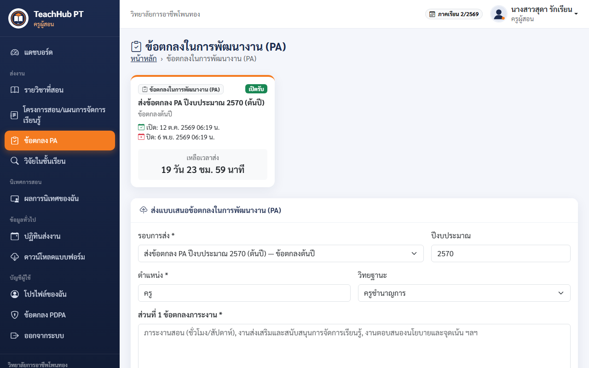

### 2.7 วิจัยในชั้นเรียน

เมนู **ส่งงาน → วิจัยในชั้นเรียน**

1. ส่ง **เค้าโครงวิจัย** ในรอบเค้าโครง
2. เมื่อเค้าโครง **ผ่าน** แล้ว จึงส่ง **รายงานวิจัยฉบับสมบูรณ์** ในรอบฉบับสมบูรณ์ โดยเลือกเค้าโครงที่ผ่าน

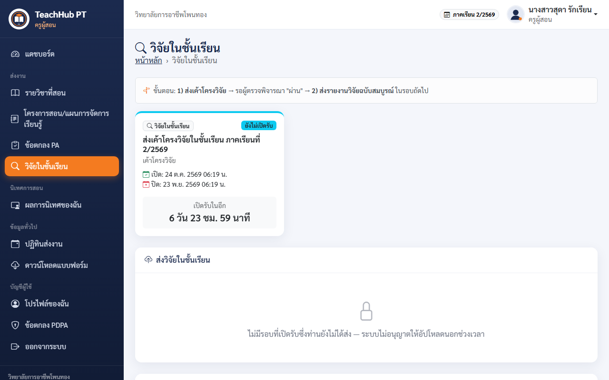

### 2.8 ผลการนิเทศของฉัน

เมนู **นิเทศการสอน → ผลการนิเทศของฉัน**

- **แท็บ 1 นิเทศโดยหัวหน้าแผนก**: ตารางนิเทศ ผลคะแนนรายด้าน จุดเด่น ข้อเสนอแนะ ภาพถ่าย → กด **รับทราบผล** และพิมพ์แบบบันทึกเป็น PDF ได้
- **แท็บ 2 ประเมินโดยนักเรียน**: QR Code ของรายวิชาตนเอง (เปิดฉายให้นักเรียนสแกน) และผลประเมินภาพรวม

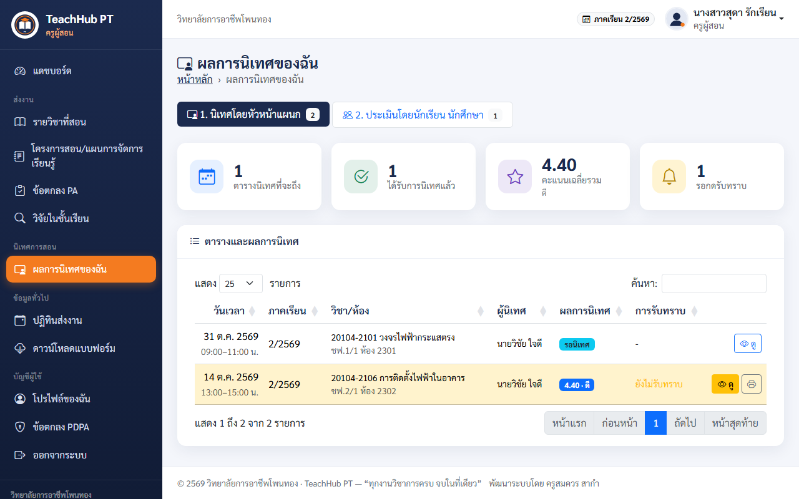

### 2.9 ผู้ตรวจงานตามตำแหน่ง

งานแต่ละประเภทมีผู้ตรวจตามตำแหน่ง ซึ่งตรวจงานของครู **ทุกแผนก** (หัวหน้าแผนกวิชายังตรวจงานของครูในแผนกได้ด้วย)

| งาน | ผู้ตรวจ |
|---|---|
| เค้าโครงวิจัย / งานวิจัยในชั้นเรียน | หัวหน้างานส่งเสริมการวิจัย นวัตกรรม และสิ่งประดิษฐ์ |
| ข้อตกลงในการพัฒนางาน (PA) | หัวหน้างานบุคลากร |
| โครงการสอน / แผนการจัดการเรียนรู้ | หัวหน้างานพัฒนาหลักสูตรและการจัดการเรียนรู้ และเจ้าหน้าที่งานพัฒนาหลักสูตรและการจัดการเรียนรู้ |

ครูที่ได้รับมอบหมายตำแหน่งข้างต้น (ผู้ดูแลระบบเป็นผู้กำหนดตำแหน่งให้) จะมีเมนู **ตรวจงาน (ตามตำแหน่ง)** เพิ่มขึ้น พร้อมตัวเลขงานที่รอตรวจ วิธีตรวจเหมือนหัวข้อ 4.1 แต่เห็นงานทุกแผนก (ยกเว้นงานของตนเอง)

1. เมนู **ตรวจงาน (ตามตำแหน่ง)** อยู่ด้านบนสุดของเมนูซ้าย ตัวเลขสีแดง = จำนวนงานที่รอตรวจ
2. กล่องด้านบนบอกตำแหน่งที่ทำให้ท่านเป็นผู้ตรวจ
3. กรองตามภาคเรียน รอบการส่ง หรือแผนกวิชาได้ แล้วกดปุ่ม **ตรวจ** ที่งานสถานะรอตรวจ

<!-- pagebreak -->

## ส่วนที่ 3 สำหรับนักเรียน นักศึกษา (ประเมินการสอน)

นักเรียน **ไม่ต้องสมัครสมาชิก** และ **ไม่ต้องใส่ชื่อ** ระบบไม่เก็บข้อมูลส่วนตัวของผู้ตอบ

1. สแกน **QR Code** ที่ครูหรือผู้ดูแลระบบให้ ด้วยกล้องโทรศัพท์
2. ตรวจชื่อครู รายวิชา และกลุ่มเรียน (เช่น ปวช. 1/1)
3. เลือกคะแนน 1-5 ให้ครบทุกข้อ (5 = มากที่สุด, 1 = น้อยที่สุด)
4. พิมพ์ข้อเสนอแนะ (ถ้ามี) แล้วกด **ส่งแบบประเมิน**
5. 1 เครื่อง/1 เบราว์เซอร์ ประเมินได้ 1 ครั้ง

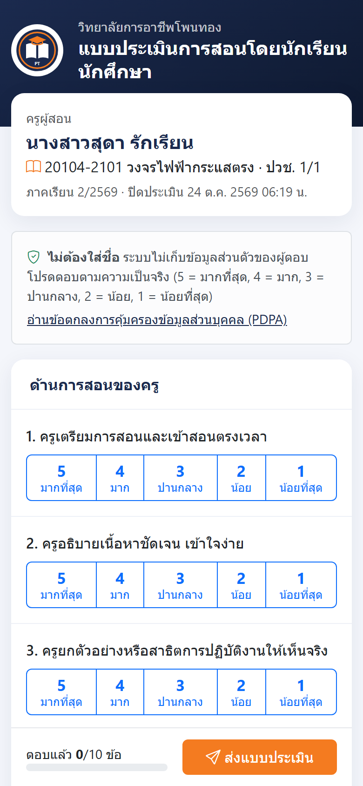

<!-- pagebreak -->

## ส่วนที่ 4 สำหรับหัวหน้าแผนกวิชา

หัวหน้าแผนกวิชาเห็นและตรวจได้เฉพาะครูในแผนกตนเอง และยังส่งงานของตนเองได้เหมือนครู (เมนู “งานของฉัน”)

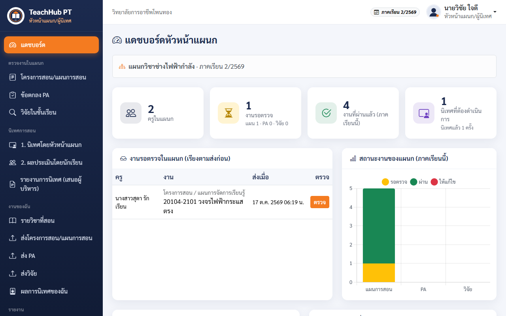

### 4.1 ตรวจงานในแผนก

เมนู **ตรวจงานในแผนก → โครงการสอน/แผนการสอน** (หรือ ข้อตกลง PA / วิจัยในชั้นเรียน)

1. กดชิป **รอตรวจ** เพื่อดูงานที่ต้องตรวจ แล้วกด **ตรวจ**
2. เปิดไฟล์ดูเนื้อหา
3. เลือก **ผ่าน** หรือ **ให้แก้ไข** (ให้แก้ไขต้องเขียนความเห็นว่าต้องแก้อะไร)
4. กด **บันทึกผลการตรวจ** ระบบพาไปงานรอตรวจรายการถัดไปให้อัตโนมัติ

### 4.2 สร้างตารางนิเทศ

เมนู **นิเทศการสอน → 1. นิเทศโดยหัวหน้าแผนก → สร้างตารางนิเทศ**

1. เลือก **ครูผู้รับการนิเทศ** และ **ภาคเรียน**
2. เลือก **รายวิชา** (แสดงเฉพาะวิชาที่แผนการจัดการเรียนรู้ของครูผ่านแล้ว)
3. กำหนดวันที่ เวลาเริ่ม-สิ้นสุด ห้องเรียน แล้วบันทึก (ระบบเตือนถ้าเวลาชนกับตารางอื่น)

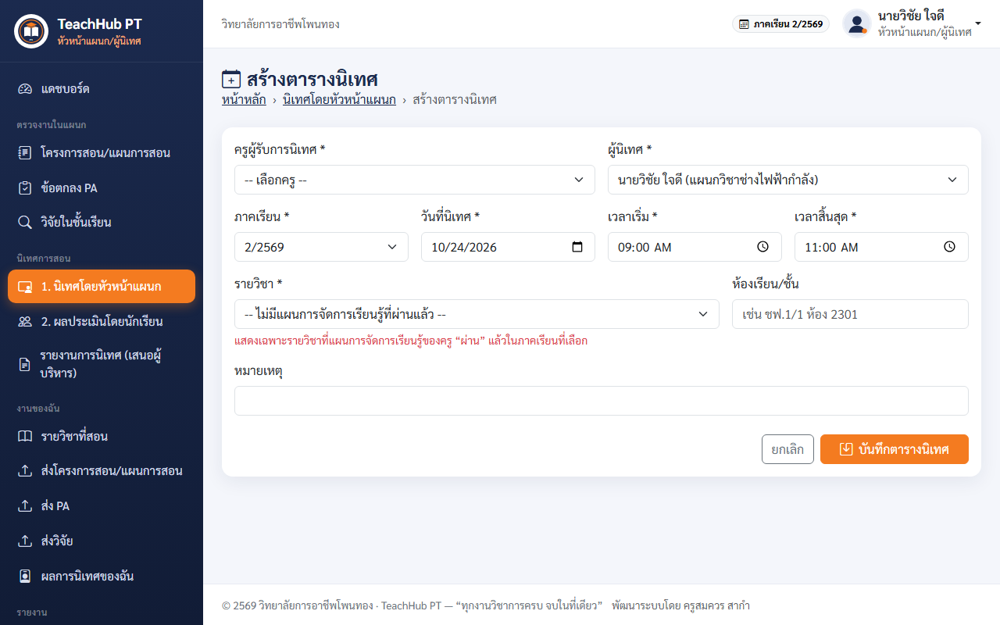

### 4.3 บันทึกผลการนิเทศ

1. ในวันนิเทศ เปิดตารางแล้วกด **บันทึกผล**
2. ให้คะแนน 1-5 ให้ครบ **15 ข้อ 6 ด้าน**
3. เขียน **จุดเด่น** และ **ข้อเสนอแนะ**
4. แนบ **ภาพถ่าย** ได้สูงสุด 10 รูป (ถ่ายจากกล้องโทรศัพท์ได้ทันที ระบบย่อขนาดให้)
5. บันทึก → ระบบคำนวณค่าเฉลี่ยและระดับคุณภาพ ครูจะเห็นผลและกดรับทราบ

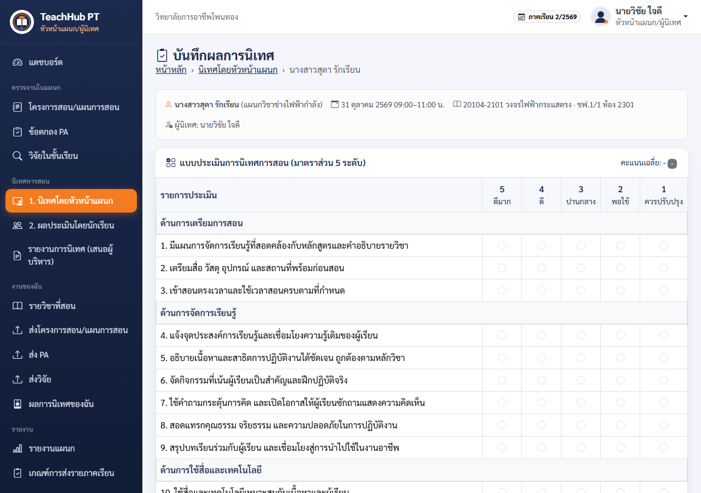

### 4.4 รายงานการนิเทศ เสนอผู้บริหาร

เมนู **นิเทศการสอน → รายงานการนิเทศ (เสนอผู้บริหาร)**

1. กด **จัดทำรายงาน** เลือกภาคเรียน/ช่วงวันที่ ระบบดึงผลนิเทศ คะแนน และภาพถ่ายให้อัตโนมัติ
2. เขียนสรุปผล จุดเด่น ปัญหา/อุปสรรค และข้อเสนอแนะ
3. กด **เสนอ** → หัวหน้างานพัฒนาหลักสูตรฯ → รองผู้อำนวยการฝ่ายวิชาการ → ผู้อำนวยการ
4. ถ้าถูก **ส่งกลับแก้ไข** จะมีแจ้งเตือนที่เมนู แก้แล้วเสนอใหม่
5. เมื่อผู้อำนวยการอนุมัติ พิมพ์ **บันทึกข้อความ** เป็น PDF ได้

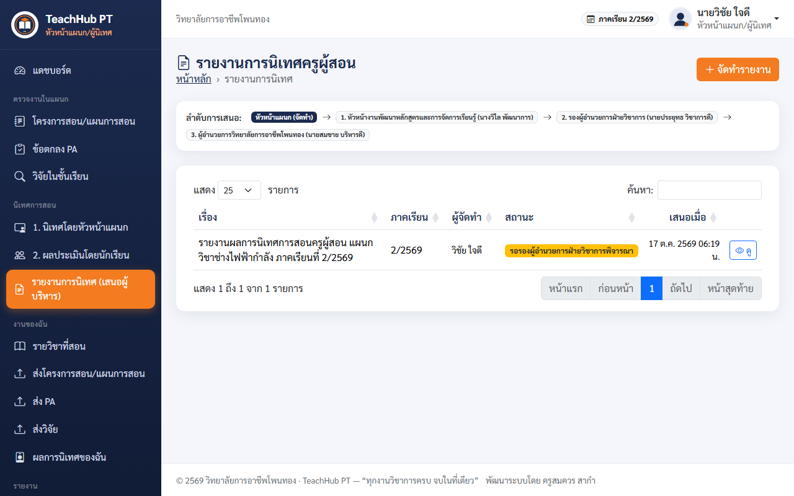

### 4.5 รายงานของแผนก

- **รายงานแผนก**: ร้อยละการส่งงานของครูในแผนก กราฟ ส่งออก Excel
- **เกณฑ์การส่งรายภาคเรียน**: ครูคนใดส่งโครงการสอนครบทุกวิชาและแผนอย่างน้อย 1 วิชาแล้วบ้าง

<!-- pagebreak -->

## ส่วนที่ 5 สำหรับผู้บริหาร

### 5.1 แดชบอร์ดผู้บริหาร

ภาพรวมทั้งวิทยาลัย: ร้อยละการส่งงานแต่ละประเภท ผลการนิเทศเฉลี่ย กราฟรายแผนก และรายงานที่รอพิจารณา (ดูได้อย่างเดียว ไม่แก้ไขข้อมูล)

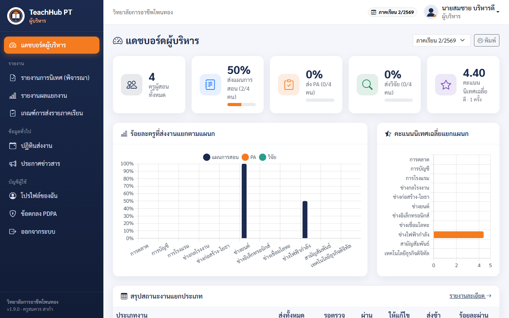

### 5.2 พิจารณารายงานการนิเทศ

เมนู **รายงาน → รายงานการนิเทศ (พิจารณา)** (ตัวเลขสีแดงบนเมนู = รายงานที่รอท่านพิจารณา)

1. เปิดรายงาน อ่านสรุปผล คะแนน และภาพถ่าย
2. เขียนความเห็น แล้วเลือก
   - ขั้น 1-2: **เห็นควรเสนอ** หรือ **ส่งกลับแก้ไข**
   - ขั้น 3 (ผู้อำนวยการ): **ทราบ/อนุมัติ** หรือ **ส่งกลับแก้ไข**
3. พิมพ์บันทึกข้อความพร้อมความเห็นทุกขั้นเป็น PDF ได้

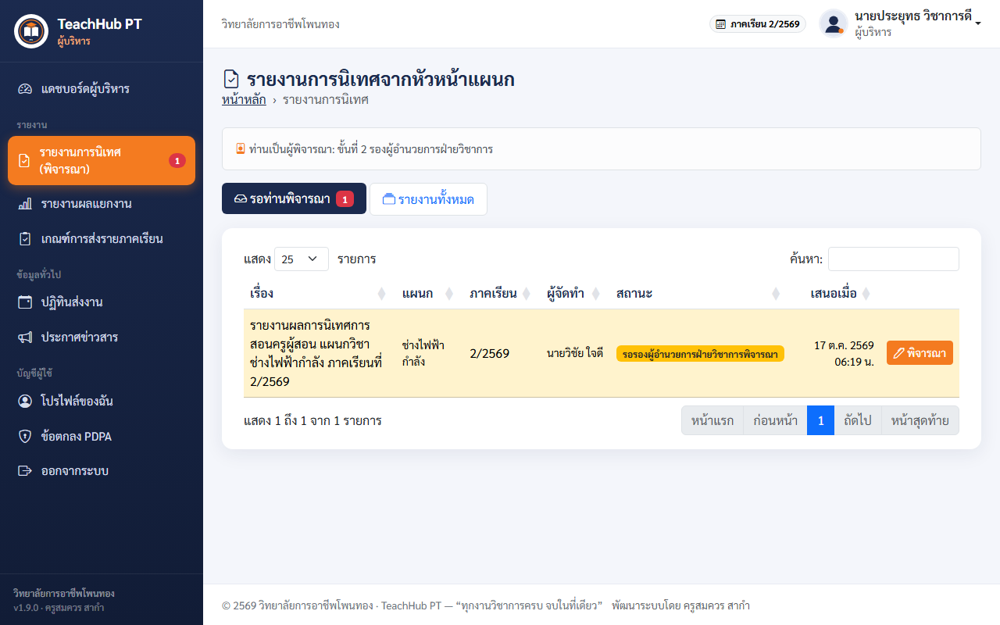

### 5.3 รายงานผล

- **รายงานผลแยกงาน**: เลือกงาน (โครงการสอน/แผน, PA, วิจัย, นิเทศ 2 รูปแบบ) กรองภาคเรียน รอบ แผนก สถานะ → ร้อยละ กราฟรายแผนก ส่งออก Excel พิมพ์ PDF
- **เกณฑ์การส่งรายภาคเรียน**: ครูคนใดส่งโครงการสอนครบทุกวิชาและแผนอย่างน้อย 1 วิชาแล้วบ้าง แยกตามแผนก

<!-- pagebreak -->

## ส่วนที่ 6 คำถามที่พบบ่อย และแบบฝึกหัดอบรม

### 6.1 คำถามที่พบบ่อย

| คำถาม | คำตอบ |
|---|---|
| สมัครแล้วเข้าระบบไม่ได้ | รอผู้ดูแลระบบอนุมัติ ถ้านานเกิน 1 วันติดต่องานพัฒนาหลักสูตรฯ |
| ลืมรหัสผ่าน | กด “ลืมรหัสผ่าน?” ที่หน้าเข้าสู่ระบบ รอผู้ดูแลระบบรีเซ็ต |
| ไม่มีรอบให้เลือกตอนส่งงาน | รอบยังไม่เปิดหรือปิดไปแล้ว ดูวันเวลาในปฏิทินส่งงาน |
| ไม่มีรายวิชาให้เลือกตอนส่งโครงการสอน/แผน | ยังไม่ได้บันทึก “รายวิชาที่สอน” ของภาคเรียนนั้น |
| อัปโหลดไฟล์ไม่ได้ | ใช้ PDF หรือ DOCX และขนาดไม่เกินที่กำหนด (แสดงใต้ช่องแนบไฟล์) |
| หัวหน้าแผนกเลือกวิชานิเทศไม่ได้ | แผนการจัดการเรียนรู้ของวิชานั้นยังไม่ “ผ่าน” |
| นักเรียนสแกน QR แล้วเปิดไม่ได้ | ตรวจว่าแบบประเมินอยู่ในช่วงเวลาเปิด แล้วแจ้งผู้ดูแลระบบ |
| นักเรียนประเมินซ้ำไม่ได้ | ระบบจำกัด 1 เครื่อง/1 ครั้ง เพื่อความถูกต้องของผล |
| ข้อมูลหาย/ผิดพลาด | แจ้งผู้ดูแลระบบ หรือตั้งกระทู้หมวด “แจ้งปัญหา” ในกระดานข่าว |
| อยากให้ระบบมีความสามารถเพิ่ม | ตั้งกระทู้หมวด “เสนอพัฒนาระบบ” ในกระดานข่าว ติดตามสถานะในกระทู้ได้ |

### 6.2 แบบฝึกหัดระหว่างอบรม (ใช้บัญชีทดลอง)

| ที่ | บทบาท | กิจกรรม | ผลที่ควรได้ |
|---|---|---|---|
| 1 | ครู | เข้าสู่ระบบ แก้ไขโปรไฟล์ อัปโหลดรูป | รูปโปรไฟล์แสดงมุมขวาบน |
| 2 | ครู | บันทึกรายวิชาที่สอน 2 วิชา | กล่องเกณฑ์แสดง 0/2 |
| 3 | ครู | ส่งโครงการสอนทั้ง 2 วิชา และแผน 1 วิชา | กล่องเกณฑ์แสดง “ครบตามเกณฑ์” |
| 4 | หัวหน้าแผนก | ตรวจแผนของครู เลือก “ให้แก้ไข” พร้อมความเห็น | ครูเห็นกรอบสีแดง |
| 5 | ครู | ส่งฉบับแก้ไข | สถานะกลับเป็นรอตรวจ ฉบับที่ 2 |
| 6 | หัวหน้าแผนก | ตรวจผ่าน แล้วสร้างตารางนิเทศวิชานั้น | วิชาแสดงในตัวเลือก |
| 7 | ครู | เปิด ผลการนิเทศของฉัน → แท็บ 2 แล้วฉาย QR Code | นักเรียนสแกนได้ |
| 8 | นักเรียน | สแกน QR ด้วยโทรศัพท์และประเมิน | หน้าขอบคุณ จำนวนผู้ตอบ +1 |
| 9 | หัวหน้าแผนก | บันทึกผลนิเทศพร้อมภาพถ่าย | ครูเห็นผลและกดรับทราบได้ |
| 10 | ผู้บริหาร | เปิดรายงานการนิเทศที่รอพิจารณา แล้วบันทึกความเห็น | รายงานไปขั้นถัดไป |
| 11 | ทุกคน | ตั้งกระทู้หมวด “สอบถามการใช้งาน” 1 กระทู้ และตอบกระทู้ของเพื่อน | กระทู้ของเพื่อนเปลี่ยนเป็น “ตอบแล้ว” |

> ติดต่อสอบถาม: งานพัฒนาหลักสูตรและการจัดการเรียนรู้ วิทยาลัยการอาชีพโพนทอง · ผู้พัฒนาระบบ ครูสมควร สากำ
